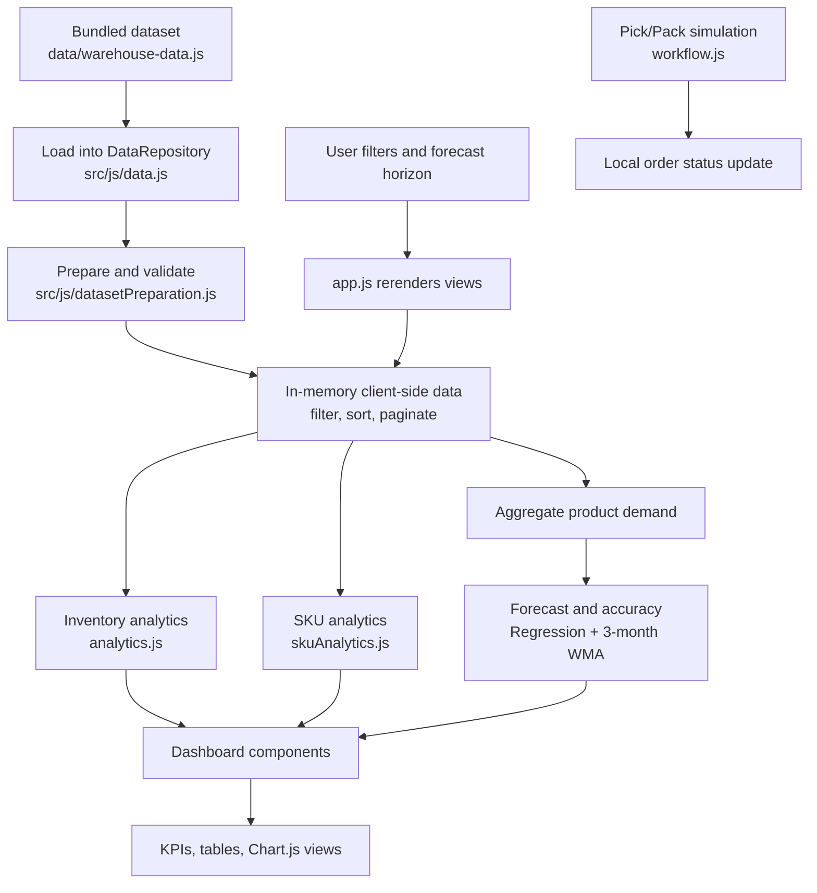

# 📦 Warehouse Inventory & Demand Dashboard

An enterprise-grade, browser-based warehouse operations dashboard visualizing stock levels across multi-location datasets, featuring an interactive pick/pack fulfillment workflow simulator, a client-side statistical forecasting engine, and a dedicated **SKU Analytics & Dataset Preparation Layer**.

---

## 🌟 Objectives & Key Highlights

- **Multi-Location Inventory Monitoring**: Track real-time stock balances across 4 regional fulfillment centers (Chicago, Dallas, New York, Los Angeles).
- **Dataset Preparation & Validation Pipeline**: Strict schema validation, string SKU preservation (protecting leading zeros), duplicate detection, currency parsing, and comprehensive validation audit reports.
- **Client-Side Data Repository Layer**: Unified asynchronous data access layer supporting `loading`, `success`, `empty`, and `error` states, reactive subscriptions, multi-criteria filtering, sorting, and pagination.
- **Deep SKU Analytics & Intelligence**: Exhaustive SKU performance metrics including price statistics (min/max/average/median), inventory velocity & months of supply coverage, price tier segmentation, and stockout risk audits.
- **Client-Side Statistical Demand Forecasting**: In-browser demand projections generated via Least Squares Linear Regression blended with 3-Month Weighted Moving Average (WMA) recency smoothing.
- **Animated Pick/Pack Workflow**: Interactive 4-stage fulfillment pipeline simulation (`Order Created` ➔ `Picking` ➔ `Packing` ➔ `Ready`).
- **Zero Third-Party Backend Dependencies**: 100% offline-ready client-side execution with bundled sample datasets and native Node.js test runner suite.
- **Modern Responsive SaaS Design System**: Built with clean CSS tokens, responsive flex/grid layouts, interactive Chart.js visualizations, and fast search filtering.

---

## 🚀 Features Overview

| Feature | Description |
| :--- | :--- |
| **Dataset Preparation Pipeline** | Validates incoming product records, protects leading-zero string SKUs, rejects anomalies (negative stock, invalid prices), detects duplicates, and produces an audit report. |
| **Client-Side Data Layer** | Reactive in-memory repository with async loading, state management (`idle`, `loading`, `success`, `empty`, `error`), subscription callbacks, pagination, and multi-field sorting. |
| **SKU Analytics & Intelligence** | Deep catalog analytics computing unique SKUs, price spectrum (min, median, max, avg), stock-to-demand coverage (months of supply), price tier breakdowns, and risk audits. |
| **Dynamic KPI Dashboard** | Computes total inventory units, valuation ($), active SKUs, warehouse count, low/critical stock counts, and average monthly demand. |
| **Interactive Filters** | Filter data reactively by Warehouse Location, Product Category, Stock Level Status (In Stock, Low, Critical), or real-time text query. |
| **Multi-Location Analytics** | Visualizes stock distribution vs total capacity utilization across regional warehouses. |
| **Demand Trends & Forecast** | Displays 12-month historical demand trends against 3-month and 6-month projected demand curves with confidence bands. |
| **Order Fulfillment Pipeline** | Live step-by-step animated pick/pack execution with telemetry event logs and status badge updates. |
| **Master Inventory Ledger** | Searchable table with visual capacity progress bars, reorder alerts, category badges, and unit valuations. |

---

## 🏗️ System Architecture

The application is structured as a modular Vanilla JavaScript (ES Modules) frontend bundled with Vite and Chart.js:

```
warehouse-inventory-demand-dashboard/
│
├── index.html                      # Main application layout and component containers
├── README.md                       # Technical documentation
├── package.json                    # Project dependencies, test runner, and Vite scripts
├── vite.config.js                  # Vite bundler configuration
│
├── docs/
│   ├── dataset.md                  # Detailed dataset schemas, preparation pipeline & audit report
│   └── architecture.md            # Data layer architecture, reactive states & SKU analytics formulas
│
├── src/
│   ├── css/
│   │   └── style.css              # Design system, CSS variables, tokens, and layout rules
│   │
│   ├── js/
│   │   ├── app.js                 # Main orchestrator & reactive event coordinator
│   │   ├── data.js                # Client-Side Data Repository & State Layer
│   │   ├── datasetPreparation.js  # Schema validation, SKU string preservation & audit reporting
│   │   ├── skuAnalytics.js        # SKU analytics engine (price stats, velocity, price tiers)
│   │   ├── analytics.js           # Top-level KPI calculation & aggregation engine
│   │   ├── forecast.js            # Statistical demand forecasting algorithm
│   │   └── charts.js              # Chart.js visualization wrappers
│   │
│   ├── components/
│   │   ├── skuAnalytics.js        # Dedicated SKU Analytics UI & interactive ledger
│   │   ├── dashboard.js           # KPI card rendering component
│   │   ├── inventory.js           # Inventory table & stock status component
│   │   ├── demand.js              # Demand charts & analytics component
│   │   ├── forecast.js            # Forecasting controls & metrics component
│   │   └── workflow.js            # Animated pick/pack workflow simulator
│   │
│   └── data/
│       └── fixtures.js            # Synthetic datasets & edge-case fixtures for testing
│
├── data/
│   └── warehouse-data.js          # Bundled multi-location sample dataset
│
└── tests/
    ├── datasetPreparation.test.js # Unit tests for dataset validation & SKU preservation
    ├── clientDataLayer.test.js    # Unit tests for reactive data repository, sorting & filtering
    ├── skuAnalytics.test.js       # Unit tests for SKU metrics, price statistics & supply coverage
    ├── inventory.test.js          # Unit tests for inventory aggregations & warehouse utilization
    └── forecasting.test.js        # Unit tests for linear regression & WMA demand forecasting
```

## 🔄 Project Workflow

1. **Dataset Loading** — `src/js/data.js` initializes the repository from the bundled products, warehouses, categories, months, and orders in `data/warehouse-data.js`.
2. **Preparation and Validation** — `src/js/datasetPreparation.js` normalizes and validates records, preserves SKU strings, and produces a validation report.
3. **Client-Side Data Processing** — `DataRepository` keeps the prepared records in browser memory and provides filtering, sorting, pagination, and accessors.
4. **Inventory and SKU Analytics** — `src/js/analytics.js` calculates dashboard and warehouse inventory metrics; `src/js/skuAnalytics.js` calculates SKU, price, stock, and coverage metrics.
5. **Demand Forecasting** — `src/js/analytics.js` aggregates product-level monthly demand. `src/js/forecast.js` combines least-squares linear regression with a three-month weighted moving average (WMA), and calculates forecast accuracy on the same product-level scope.
6. **Dashboard Visualization** — Components render KPIs, tables, and Chart.js visualizations through `src/js/charts.js`.
7. **User Interaction and Pick/Pack Workflow** — `src/js/app.js` passes warehouse, category, stock-status, and search filters to the relevant views and rerenders them when controls change. `src/components/workflow.js` simulates an order through Created, Picking, Packing, and Ready stages. Warehouse selection affects inventory views; historical demand is product-level and is not split by warehouse.



---

## 📊 Dataset Preparation Rules & Schema

Full schema specifications are documented in [`docs/dataset.md`](./docs/dataset.md). Key rules include:

1. **SKU String Preservation**: SKU identifiers are strictly preserved as strings (via `normalizeSku()`) to prevent accidental numeric coercion that strips leading zeros (e.g. `"00123"` $\rightarrow$ `123`).
2. **Sanitation & Coercion**: Currency strings (e.g., `"$149.50"`) are parsed safely; whitespace is trimmed; categories are matched against catalog taxonomy.
3. **Integrity Validation**: Rejects records with missing mandatory fields (`id`, `sku`, `name`, `category`, `unitPrice`), negative prices, or negative stock quantities.
4. **Duplicate Detection**: Flags duplicate SKUs and duplicate IDs across incoming records.
5. **Validation Audit Report**: Every ingestion produces an audit summary detailing valid counts, rejected records with specific error reasons, warnings, and compliance rates.

---

## 🏷️ SKU Analytics & Intelligence

Implemented in `src/js/skuAnalytics.js` and rendered via `src/components/skuAnalytics.js`:

- **Catalog SKU Count**: Total unique SKUs vs total product records, with duplicate status.
- **Price Spectrum**: Minimum, maximum, average, and median unit pricing.
- **Stock Concentration**: Minimum, maximum, average, and median on-hand stock per SKU.
- **Months of Supply Coverage**:
  $$\text{Months of Supply} = \frac{\text{On-Hand Stock}}{\text{Latest Monthly Demand}}$$
  Flags stockout risk when supply is under $1.0$ month. Safely returns `null` for zero-demand items without fabricating numbers.
- **Category SKU Distribution**: SKU count, valuation, average price, and catalog share per category.
- **Price Tiers**: Segmentation across Budget ($< \$50$), Standard ($\$50-\$100$), Mid-Tier ($\$100-\$250$), and Premium ($\$250+$).
- **Interactive SKU Ledger**: Real-time search by SKU code or name, with multi-column sorting (by SKU, Name, Unit Price, Stock Level, Valuation, Supply Coverage).

---

## 🛠️ Local Development & Testing

### Prerequisites
- Node.js (v18+ or v20+ recommended)
- npm or yarn

### Installation & Execution

1. **Install Dependencies**:
   ```bash
   npm install
   ```

2. **Run All Unit & Integration Tests**:
   ```bash
   npm test
   ```
   *Runs 40 native test assertions across 11 test suites covering dataset preparation, client data layer, SKU analytics, inventory KPIs, and forecasting.*

3. **Start Development Server**:
   ```bash
   npm run dev
   ```
   Open your browser at `http://localhost:5173`.

4. **Build Production Bundle**:
   ```bash
   npm run build
   ```
   Validates bundle compilation via Vite.

5. **Preview Production Build**:
   ```bash
   npm run preview
   ```

---

## 📄 License

MIT License - free for educational, portfolio, and commercial demonstration use.
